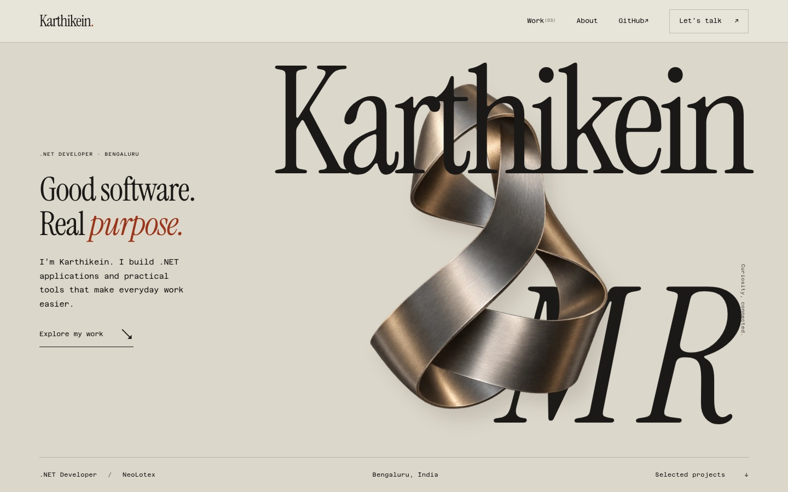

# Karthikein M R: portfolio

**What:** my personal site: who I am and three projects I built (AutoDev Agents, Lead Finder, Kalvio Build).
**For:** clients and employers who want to see my work and contact me.
**Run:** in this folder, `python3 -m http.server 8000`, then open http://localhost:8000. No install, no build step.

Live: https://karthikkushi.github.io/

Test: `node tests/interactions.cjs` checks the project panels, keyboard navigation and that every local file the page uses exists.

Plain HTML, CSS and JavaScript, published by GitHub Pages from `main`. The old address `/karthik-portfolio/` redirects to the home page.
